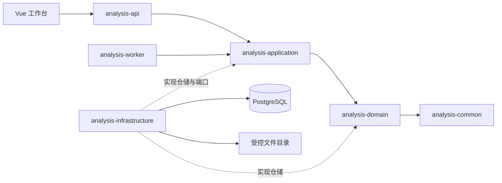

# 系统架构与目录边界

本项目采用模块化单体。API 负责同步请求，Worker 负责异步执行和维护；数据库和受控文件存储是持久化边界。目录决策见 [ADR-0001](decisions/0001-enterprise-repository-layout.md)。

## 模块与调用关系



图中是职责与调用关系。Maven 直接依赖为 `api/worker → infrastructure → application → domain → common`，API 和 Worker 是组合根，负责加载基础设施适配器。两者不互相依赖。

## 现有业务链路

1. **导入**：`BatchController` / `ImportTaskController` 接收服务端 Principal，应用服务建立批次与任务；POI 校验模板；VALID 文件转为事实和来源明细；JDBC 保存事实、任务和问题。文件写入采用异常补偿，数据库操作采用事务。
2. **计算**：`CalculationServiceImpl` 检查批次状态和授权 scope，以 scope 聚合事实，用 BigDecimal 形成实际、预算、GAP 与损益结果。当前普通计算仍创建 R1，完整版本快照接入见报告中的待整改项。
3. **确认/发布**：从 CALCULATED 到 CONFIRMED 再到 PUBLISHED。确认和发布带事务；发布前执行 PVM 勾稽。已确认或发布批次不直接重算。
4. **查询**：经营总览、指标树、PVM、V1.3 专题读取结果及受权限过滤的事实；FC 使用独立版本与快照。尚无数据或口径的接口返回阻断状态。
5. **治理扩展**：人工修订、计算历史、重试租约、Outbox 投递、导出快照与清理均已有服务/适配器；存在这些类和表不代表普通计算已贯通全部机制。
6. **AI**：`LocalAiGateway` 当前实现是规则摘要，读取结果后生成六段草稿，不是已接入正式模型的证明。

## 数据责任

| Schema | 职责 |
|---|---|
| meta | 月度批次等元数据 |
| flow | 导入、配置导入、导出等任务及问题 |
| raw | 标准损益事实、原始行来源追溯 |
| cfg | 映射、指标等配置 |
| calc | 结果、FC、计算版本与快照、人工修订、重试及事件 |
| iam | 用户角色、视角和范围 |
| audit | 审计事件 |
| mart | 建立的查询层命名空间，不能据此认定完整数仓已实现 |

迁移版本是唯一结构演进路径，不改动已执行 SQL。后续需要迁移历史/校验和管理；本次没有引入新的迁移框架。

## 实际工程目录

```text
repo/
├── pom.xml / Makefile / README.md / CONTRIBUTING.md / CHANGELOG.md
├── .github/                       # CI 与评审配置
├── backend/                       # 六个 Maven 模块，维持既有相对路径
├── frontend/
│   ├── src/App.vue / main.ts       # 应用装配
│   ├── src/features/workbench/    # 当前业务工作台、导航、样式
│   ├── src/shared/api/            # contracts / http / index
│   ├── tests/unit/               # Vitest
│   └── e2e/                      # Playwright
├── database/                     # migration / verification / rollback
├── deploy/                       # docker / config / scripts
├── scripts/                      # 仓库检查
├── templates/import/             # 导入模板
├── tests/security/               # 跨模块安全脚本
├── demo/                         # 独立原型
└── docs/
    ├── requirements/             # 需求与业务规则
    ├── governance/               # 项目治理
    ├── planning/                 # 实施计划
    ├── architecture/decisions/   # 架构与 ADR
    ├── development/              # 本地环境和验证
    ├── api/ / testing/ / operation/
    ├── reports/                  # 核验报告
    └── archive/                  # 历史快照
```

## 下一阶段内部领域拆分

当前 Java 仍以 `model/service/repository/jdbc` 横向组织。下一阶段在现有六模块内逐个建立 `ingestion`、`calculation`、`forecast`、`configuration`、`authorization`、`reporting` 和 `audit` 业务包；通过端口交互，不直接跨包修改聚合。避免同时增加同名 Maven 子模块和空目录。

先抽离无副作用的损益/PVM规则并固定黄金样本，再迁移计算编排和 Spring 装配。每个业务包迁移必须同时更新 import、扫描范围、配置、测试及技术文档。本轮未改 Java 主业务包，避免把全量包重命名与财务行为修改混在一起。
